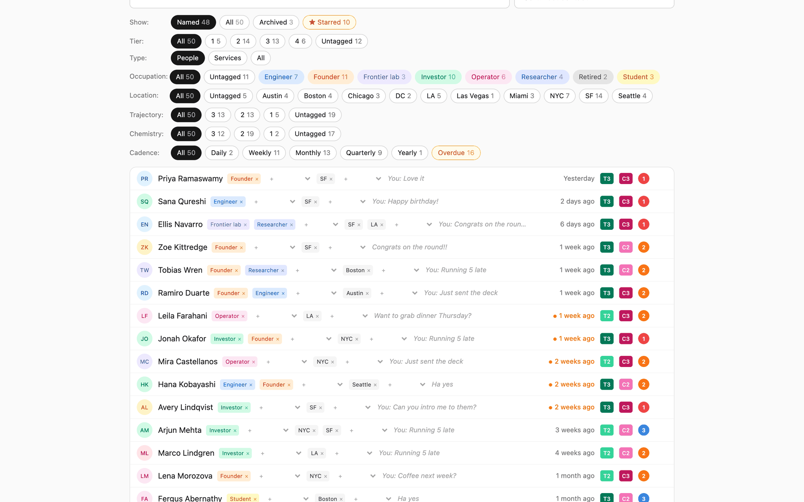
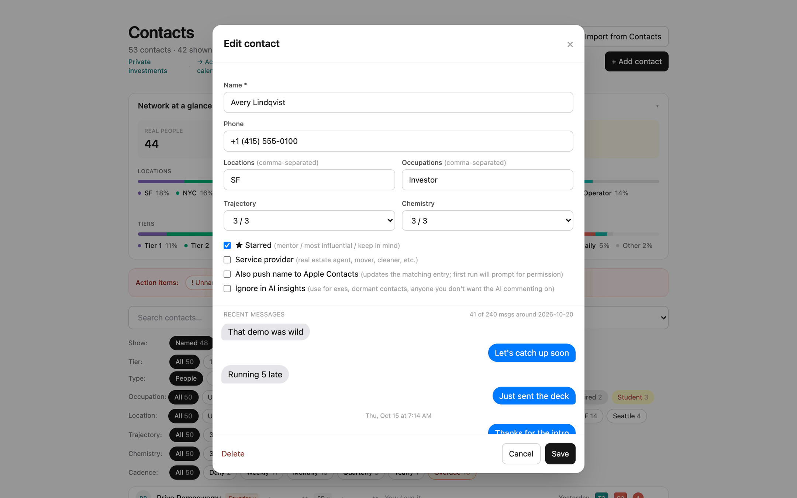
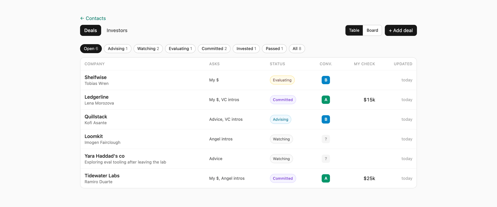

# Personal CRM

A local Flask app (macOS) for keeping up with people.

- **Contacts** (`/`): tiers, locations, occupations, stars, archive, cadence (computed from
  macOS Messages and call history, with manual overrides), AI insights.
- **Activity calendar** (`/calendar`): how many people you talked to each day.
- **Deals** (`/deals`): deals you're advising/evaluating/invested in, founders, which investors
  you've shared them with, and investor suggestions per deal.

All data lives in a local SQLite file (`crm.db`), which is gitignored along with backups,
CSV exports and `.env`.

Private-investment tracking (positions, pacing, public-market benchmark) used to live here
too; it is now a separate app.

## Screenshots

All taken from the fake demo dataset (see [Demo with fake data](#demo-with-fake-data)).

Contacts, sorted by last contact, with tier, chemistry and cadence badges:


A contact, with recent messages pulled from Messages:


Deals you're advising, watching, evaluating or committed to:



## Setup

```sh
python3 -m venv venv
./venv/bin/pip install flask anthropic
echo "ANTHROPIC_API_KEY=sk-ant-..." > .env   # optional: AI insights
./run.sh                                      # http://127.0.0.1:5555
```

Reading Messages and call history needs Full Disk Access for the Python binary
(System Settings → Privacy & Security → Full Disk Access).

## Demo with fake data

`seed_demo.py` builds a fully made-up dataset (about 50 contacts, deals in every status,
investor profiles) plus fake Messages and call-history databases. Every name, company, phone
number (555-01xx) and email (example.com) is fictional.

```sh
./venv/bin/python seed_demo.py                     # writes demo.db, demo_messages.db, demo_calls.db
CRM_DEMO=1 PORT=5556 ./venv/bin/python app.py      # http://127.0.0.1:5556
```

With `CRM_DEMO=1` the app reads only those demo files: it never opens `crm.db`, your real
Messages / call history / Contacts, never pushes names to Apple Contacts, and skips backups.

## Environment

| Variable | Default | |
|---|---|---|
| `CRM_DB` | `crm.db` (`demo.db` in demo mode) | SQLite path |
| `CRM_DEMO` | unset | `1` = demo mode (see above) |
| `PORT` | `5555` | |
| `ANTHROPIC_API_KEY` | unset | AI insights |
